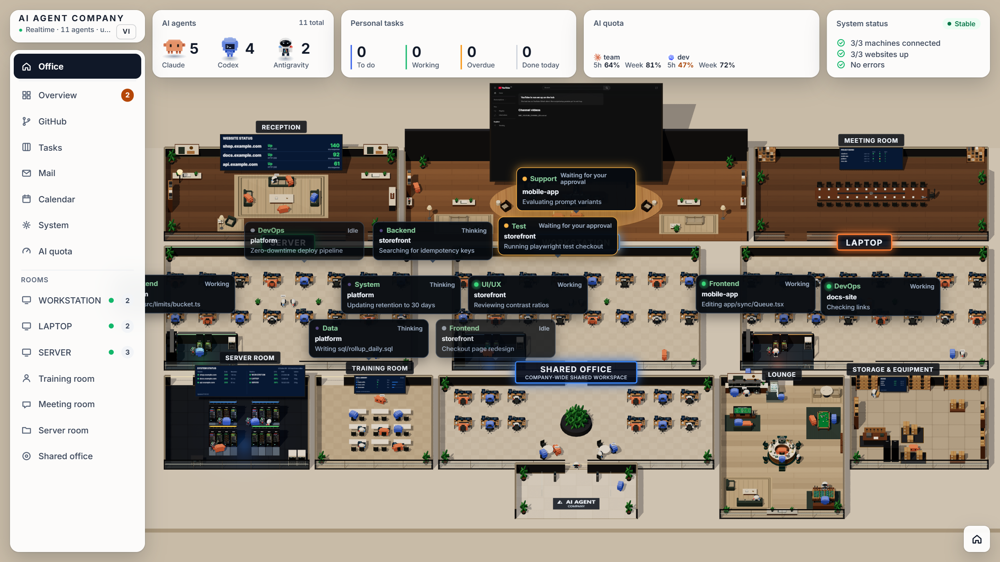

# AI Agent Company



**English** · [Tiếng Việt](README.vi.md)

A 3D tabletop office for watching and steering the Claude Code / Claude Desktop, Codex Desktop and Antigravity sessions running on one or more machines. Each agent session is a voxel character seated at a desk for its kind of work. When an agent needs your decision, its character queues at the CEO desk and you approve it right in the browser.

Every number is real data read from your machines. A source that is not configured shows "Source not connected" instead of placeholder figures. The screenshot above uses demo mode (`MSC_DEMO=1`), which shows sample agents without reading anything from your machine.

## Features

- **3D office** (Three.js): three machine rooms, a meeting room, a server room, a training room and a lounge (pool table, foosball, coffee bar). Characters walk around, speech bubbles appear when agents message each other, and finished work gets a sign-off effect. The operating system's reduced-motion setting is respected.
- **Agent tracking**: reads Claude (`~/.claude`), Codex (`~/.codex/sessions`) and Antigravity (`~/.gemini/antigravity`) sessions on the machine itself, and infers each agent's role from the task prompt, the files it edits and the commands it runs.
- **Approve and answer from the web**:
  - Claude: through the official `PermissionRequest` hook. Allow, always allow as Claude suggests, deny with a reason, or deny and stop the turn; answer `AskUserQuestion`; comment on an `ExitPlanMode` plan. Whichever side answers first (app or web) wins.
  - Codex Desktop: answer questions and approve commands and file edits for the exact chat that is waiting.
  - Stop a running turn, and change Codex's model and reasoning effort for the next turn.
  - Every action has a receipt and is sent once; an uncertain result is never resent automatically.
- **Hand work between agents**: send a message to a running session through [codex-mcp-bridge](https://www.npmjs.com/package/@minhspark/codex-mcp-bridge); the route, the packet and its status show up in the office.
- **Operations**: an inbox of items that need you, a work board by project and machine (working, waiting for approval, testing, needs sign-off, done), an activity log with 7-day replay, and a daily report.
- **Tabs**: Overview, GitHub (PRs, CI and issues through `gh`), personal tasks, Mail (Gmail), Calendar (Google Calendar), System (machine health, services, processes, scheduled jobs) and AI quota (through Quota Control).
- **YouTube screen** at the CEO desk: TV-style sign-in with your own YouTube account.
- **English and Vietnamese**: switch with the EN/VI button in the top-left card or in the Overview toolbar. The choice is stored in the browser; `?lang=en` or `?lang=vi` in the URL also works.

## Requirements

- Node.js 23 or later (type stripping and `node:sqlite`).
- pnpm.
- Optional: a signed-in [GitHub CLI](https://cli.github.com) for the GitHub tab; [Tailscale](https://tailscale.com) for several machines; [Quota Control](https://github.com/buidangminh23/quota-control) for the AI quota tab; [PowerShell 7](https://github.com/PowerShell/PowerShell) for the setup scripts.

## Quick start

```bash
pnpm install
cp .env.example .env
pnpm build
node server/hub.ts
```

Open http://127.0.0.1:5190. To try it without any agents running, start the hub with demo mode:

```bash
MSC_DEMO=1 node server/hub.ts
```

For frontend development, run Vite and open http://127.0.0.1:5180:

```bash
node node_modules/vite/bin/vite.js
```

Checks: `pnpm test` and `pnpm build`.

## Configuration

All configuration lives in a `.env` file in the hub's working directory (change the path with `MSC_ENV_FILE`). Never commit `.env`.

| Variable | Meaning |
|---|---|
| `MSC_PORT`, `MSC_HOST` | Listening port and address (several addresses separated by commas) |
| `MSC_TOKEN` | Access token. Required when the hub listens beyond localhost |
| `MSC_PUBLIC_URL` | Public HTTPS address (for example Tailscale Serve) to redirect to |
| `MSC_MACHINE` | Whether this machine is `WORKSTATION`, `LAPTOP` or `SERVER` |
| `MSC_ROLE` | `hub` (default) or `collector` |
| `MSC_LANG` | Language of messages the hub and the Claude hook write: `en` (default) or `vi`. The web UI follows the browser setting |
| `MSC_DEMO` | `1` shows sample agents, machines, quota and sites instead of real data |
| `MSC_COLLECTORS` | Collectors on other machines: `SERVER=http://100.x.x.x:5190,LAPTOP=http://...` |
| `MSC_SITES` | Websites to monitor: `https://a.com|Name A,https://b.com|Name B` |
| `MSC_GITHUB_PINNED` | Repositories pinned to the top of the GitHub tab: `web,api,docs` |
| `MSC_QUOTA_URL` | Quota Control limits API |
| `MSC_AUTOMATION_FILE` | JSON file describing scheduled jobs (default `~/.msc-company/automation.json`) |
| `MSC_GMAIL_ACCOUNTS` | Gmail `email:app-password`, several accounts separated by commas |
| `MSC_CALENDAR_ICS` | Secret iCal link of a Google Calendar |
| `MSC_YOUTUBE_CLIENT_ID`, `MSC_YOUTUBE_CLIENT_SECRET` | OAuth client of type "TVs and Limited Input devices" |
| `MSC_YOUTUBE_CHANNEL_ID` | Channel shown before you sign in to YouTube (optional) |
| `MSC_YOUTUBE_REGION` | Region for YouTube charts (default `VN`) |

Local data (activity log, receipts, tasks, YouTube session) is stored in `~/.msc-company/`.

### Gmail and calendar

Gmail is read over read-only IMAP with an App Password of your own account; no Google Cloud app is needed. Run:

```bash
pwsh scripts/setup-google-inbox.ps1
```

The script opens the App Password page, verifies a real sign-in, then writes it to `.env`. Restart the hub afterwards.

### YouTube

Enable the YouTube Data API v3 in your own Google Cloud project, create an OAuth client of type "TVs and Limited Input devices", then run:

```bash
pwsh scripts/setup-youtube.ps1
```

Restart the hub, open the screen at the CEO desk and click Sign in.

### Approving Claude from the web

On every machine that runs Claude Code, install the hook once:

```bash
node server/claude-hook/install.mjs
```

Preview with `--dry-run`, check with `--status`, remove with `--uninstall`. The script backs up `~/.claude/settings.json` before changing it.

### Several machines

The hub runs on one machine. The others run a collector that the hub polls over a private network (Tailscale recommended):

```bash
pwsh scripts/install-collector.ps1 -Token <token> -Machine SERVER
bash scripts/install-collector-mac.sh <token> LAPTOP
```

On Windows, `pwsh scripts/install-hub.ps1` starts the hub when you sign in.

### Scheduled jobs

The System tab shows the status of periodic jobs you describe in `~/.msc-company/automation.json`, per operating system:

```json
{
  "win32": [
    { "id": "backup", "name": "Backup", "group": "sync", "schedule": "02:00 daily", "file": "~/logs/backup.log", "staleHours": 30 }
  ]
}
```

`group` is `sync`, `update` or `cleanup`. Without a `format`, each timestamped log line counts as one change.

## Limitations

- **Codex approvals are pinned to tested Codex Desktop builds.** Answering, approving and stopping Codex chats from the web works only with Codex Desktop 26.1027.3384.0 on Windows and 26.1027.51404 (build 23880) on macOS (`CODEX_WINDOWS_VERSIONS` and `CODEX_MAC_VERSIONS` in `server/reply-adapters/codex.ts`). On any other version the hub refuses these actions with an error, because it talks to Codex's internal app channel and will not guess at an untested one. Watching Codex sessions works on every version.
- **Times are shown in Vietnam time (UTC+7).** Dashboards, the calendar and the activity log use `Asia/Ho_Chi_Minh` regardless of your machine's time zone.
- **Three fixed machine slots.** The office has rooms for `WORKSTATION`, `LAPTOP` and `SERVER`; a fourth machine has no room of its own.
- **Starting automatically is Windows-only for the hub.** `install-hub.ps1` registers a Windows scheduled task. On macOS and Linux, start the hub yourself (for example with launchd or systemd). Collectors have installers for Windows and macOS only.
- **Several machines need a private network.** Collectors are reached over HTTP with a shared token; use Tailscale or another private network, never the open internet.
- **Gmail and Google Calendar are read-only.** Mail is read over IMAP and the calendar from its secret iCal link. Events you create in the Calendar tab are stored on the hub only and are not written to Google Calendar.
- **Claude approvals need the hook.** Without `server/claude-hook/install.mjs` on a machine, its Claude sessions are visible but cannot be approved from the web.
- **The AI quota tab needs Quota Control** running on the hub machine; without it the tab shows "Source not connected".
- **Bridge identifiers keep their original names** (for example in `codex-mcp-bridge` messages), so the office can show handoffs from existing installations.

## Security

- The hub listens on `127.0.0.1` by default. When you expose it to a network, set `MSC_TOKEN` and use a private network only.
- Write actions (approve, answer, stop, hand off work) check Origin/Host and an action header, and require the token even from localhost.
- The web never approves anything on your behalf and does not replace plan approval inside the Claude app.

## Trademarks

Claude, Codex, Antigravity, Gmail, YouTube and the logos in `public/brands` and `public/logos` belong to their respective owners and are used only to identify those applications. This project is not affiliated with those companies.

## License

MIT. See [LICENSE](LICENSE).
