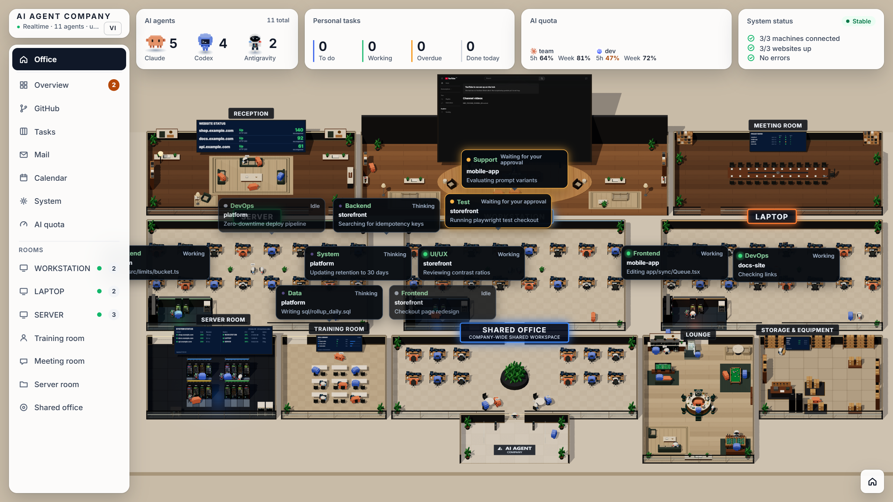

<h1 align="center">AI Agent Company</h1>



Văn phòng 3D kiểu sa bàn để theo dõi và điều hành các phiên Claude Code / Claude Desktop, Codex Desktop và Antigravity đang chạy trên một hoặc nhiều máy. Mỗi phiên agent là một nhân vật voxel ngồi đúng bàn theo vai việc; khi agent cần bạn quyết định, nhân vật xếp hàng trước bàn CEO và bạn duyệt ngay trên web.

Mọi số liệu là dữ liệu thật đọc từ máy của bạn. Nguồn nào chưa cấu hình thì hiện "Chưa nối nguồn", không dùng số giả. Ảnh trên chụp ở chế độ demo (`MSC_DEMO=1`): hiện agent mẫu, không đọc gì từ máy của bạn.

## Tính năng

- **Văn phòng 3D** (Three.js): 3 phòng máy, phòng họp, phòng máy chủ, phòng đào tạo, khu sinh hoạt (bi-a, bi-lắc, quầy cà phê). Nhân vật di chuyển, bong bóng thoại khi agent nhắn nhau, hiệu ứng nghiệm thu; tôn trọng tuỳ chọn giảm chuyển động của hệ điều hành.
- **Theo dõi agent**: đọc phiên Claude (`~/.claude`), Codex (`~/.codex/sessions`) và Antigravity (`~/.gemini/antigravity`) ngay trên máy, tự nhận diện vai từ câu giao việc, file đang sửa và lệnh đang chạy.
- **Duyệt và trả lời từ web**:
  - Claude: qua hook chính thức `PermissionRequest`. Cho phép, luôn cho phép theo gợi ý của Claude, từ chối kèm lý do, từ chối và dừng lượt; trả lời `AskUserQuestion`; góp ý kế hoạch `ExitPlanMode`. Bên nào trả lời trước (app hay web) thì thắng.
  - Codex Desktop: trả lời câu hỏi, duyệt lệnh và duyệt sửa file của đúng chat đang chờ.
  - Dừng lượt đang chạy, đổi model và mức suy nghĩ của Codex cho lượt sau.
  - Mọi thao tác đều có biên nhận, chỉ gửi một lần; kết quả chưa rõ không tự gửi lại.
- **Giao việc giữa agent**: gửi tin tới phiên đang chạy qua [codex-mcp-bridge](https://www.npmjs.com/package/@minhspark/codex-mcp-bridge); đường truyền, gói tin và trạng thái hiện trong văn phòng.
- **Điều hành**: hộp việc cần xử lý, bảng công việc theo dự án/máy (đang làm, chờ duyệt, kiểm thử, cần nghiệm thu, hoàn tất), nhật ký và xem lại 7 ngày, báo cáo ngày.
- **Tab**: Tổng quan, GitHub (PR, CI, issue qua `gh`), Công việc cá nhân, Thư (Gmail), Lịch (Google Calendar), Hệ thống (sức khoẻ máy, dịch vụ, tiến trình, tác vụ tự động), Hạn mức AI (qua Quota Control).
- **Màn YouTube** ở bàn CEO: đăng nhập kiểu TV bằng tài khoản YouTube của chính bạn.
- **Tiếng Anh và tiếng Việt**: đổi bằng nút EN/VI ở ô góc trên trái hoặc trên thanh công cụ tab Tổng quan. Lựa chọn lưu trong trình duyệt; thêm `?lang=vi` hoặc `?lang=en` vào địa chỉ cũng được.

## Yêu cầu

- Node.js 23 trở lên (dùng type stripping và `node:sqlite`).
- pnpm.
- Tuỳ chọn: [GitHub CLI](https://cli.github.com) đã đăng nhập cho tab GitHub; [Tailscale](https://tailscale.com) nếu dùng nhiều máy; [Quota Control](https://github.com/buidangminh23/quota-control) cho tab Hạn mức; [PowerShell 7](https://github.com/PowerShell/PowerShell) cho các script cài đặt.

## Chạy nhanh

```bash
pnpm install
cp .env.example .env
node server/hub.ts
```

Mở http://127.0.0.1:5190 sau khi build giao diện (`pnpm build`). Muốn xem thử khi chưa có agent nào chạy, bật chế độ demo:

```bash
MSC_DEMO=1 node server/hub.ts
```

Hoặc chạy giao diện ở chế độ phát triển:

```bash
node node_modules/vite/bin/vite.js
```

rồi mở http://127.0.0.1:5180.

Kiểm tra: `pnpm test` và `pnpm build`.

## Cấu hình

Mọi cấu hình nằm trong file `.env` ở thư mục chạy hub (đổi đường dẫn bằng `MSC_ENV_FILE`). File `.env` không bao giờ được commit.

| Biến | Ý nghĩa |
|---|---|
| `MSC_PORT`, `MSC_HOST` | Cổng và địa chỉ lắng nghe (nhiều địa chỉ ngăn bằng dấu phẩy) |
| `MSC_TOKEN` | Mã truy cập. Bắt buộc khi mở hub ra ngoài localhost |
| `MSC_PUBLIC_URL` | Địa chỉ HTTPS công khai (ví dụ Tailscale Serve) để tự chuyển hướng |
| `MSC_MACHINE` | Máy này là `WORKSTATION`, `LAPTOP` hay `SERVER` |
| `MSC_ROLE` | `hub` (mặc định) hoặc `collector` |
| `MSC_LANG` | Ngôn ngữ thông báo do hub và hook Claude ghi: `en` (mặc định) hoặc `vi`. Giao diện web theo lựa chọn trong trình duyệt |
| `MSC_DEMO` | `1` để hiện agent, máy, hạn mức và web mẫu thay cho dữ liệu thật |
| `MSC_COLLECTORS` | Collector của các máy khác: `SERVER=http://100.x.x.x:5190,LAPTOP=http://...` |
| `MSC_SITES` | Web cần theo dõi: `https://a.com|Tên A,https://b.com|Tên B` |
| `MSC_GITHUB_PINNED` | Repo ghim lên đầu tab GitHub: `web,api,docs` |
| `MSC_QUOTA_URL` | API hạn mức của Quota Control |
| `MSC_AUTOMATION_FILE` | File JSON khai tác vụ tự động (mặc định `~/.msc-company/automation.json`) |
| `MSC_GMAIL_ACCOUNTS` | `email:app-password` của Gmail, nhiều tài khoản ngăn bằng dấu phẩy |
| `MSC_CALENDAR_ICS` | Link iCal bí mật của Google Calendar |
| `MSC_YOUTUBE_CLIENT_ID`, `MSC_YOUTUBE_CLIENT_SECRET` | OAuth client loại "TVs and Limited Input devices" |
| `MSC_YOUTUBE_CHANNEL_ID` | Kênh hiện khi chưa đăng nhập YouTube (tuỳ chọn) |
| `MSC_YOUTUBE_REGION` | Khu vực cho bảng xếp hạng YouTube (mặc định `VN`) |

Dữ liệu cục bộ (nhật ký, biên nhận, công việc, phiên đăng nhập YouTube) nằm trong `~/.msc-company/`.

### Gmail và lịch

Gmail đọc qua IMAP chỉ đọc bằng App Password của chính bạn; không cần tạo Google Cloud app. Chạy:

```bash
pwsh scripts/setup-google-inbox.ps1
```

Script mở trang tạo App Password, kiểm tra đăng nhập thật rồi ghi vào `.env`. Khởi động lại hub sau đó.

### YouTube

Bật YouTube Data API v3 trong Google Cloud của bạn, tạo OAuth client loại "TVs and Limited Input devices", rồi chạy:

```bash
pwsh scripts/setup-youtube.ps1
```

Khởi động lại hub, mở màn hình bàn CEO và bấm Đăng nhập.

### Duyệt Claude từ web

Trên mỗi máy chạy Claude Code, cài hook một lần:

```bash
node server/claude-hook/install.mjs
```

Xem trước bằng `--dry-run`, kiểm tra bằng `--status`, gỡ bằng `--uninstall`. Script sao lưu `~/.claude/settings.json` trước khi sửa.

### Nhiều máy

Hub chạy trên một máy, các máy còn lại chạy collector và được hub gọi qua mạng riêng (khuyên dùng Tailscale):

```bash
pwsh scripts/install-collector.ps1 -Token <mã> -Machine SERVER
bash scripts/install-collector-mac.sh <mã> LAPTOP
```

Trên Windows có thể cho hub tự chạy khi đăng nhập bằng `pwsh scripts/install-hub.ps1`.

### Tác vụ tự động

Tab Hệ thống hiện trạng thái các tác vụ định kỳ bạn khai trong `~/.msc-company/automation.json`, theo từng hệ điều hành:

```json
{
  "win32": [
    { "id": "backup", "name": "Sao lưu", "group": "sync", "schedule": "02:00 hằng ngày", "file": "~/logs/backup.log", "staleHours": 30 }
  ]
}
```

`group` là `sync`, `update` hoặc `cleanup`. Không khai `format` thì mỗi dòng log có thời gian được coi là một thay đổi.

## Giới hạn

- **Duyệt Codex chỉ chạy trên bản Codex Desktop đã kiểm thử.** Trả lời, duyệt và dừng chat Codex từ web chỉ hoạt động với Codex Desktop 26.1027.3384.0 trên Windows và 26.1027.51404 (build 23880) trên macOS (`CODEX_WINDOWS_VERSIONS` và `CODEX_MAC_VERSIONS` trong `server/reply-adapters/codex.ts`). Bản khác thì hub từ chối và báo lỗi, vì nó nói chuyện qua kênh nội bộ của Codex và không đoán trên bản chưa kiểm thử. Theo dõi phiên Codex vẫn chạy với mọi bản.
- **Giờ hiển thị theo giờ Việt Nam (UTC+7).** Bảng điều hành, lịch và nhật ký dùng `Asia/Ho_Chi_Minh`, không theo múi giờ của máy.
- **Ba chỗ máy cố định.** Văn phòng có phòng cho `WORKSTATION`, `LAPTOP` và `SERVER`; máy thứ tư không có phòng riêng.
- **Tự chạy hub khi đăng nhập chỉ có cho Windows.** `install-hub.ps1` tạo scheduled task của Windows; trên macOS và Linux cần tự khởi động hub (ví dụ bằng launchd hoặc systemd). Script cài collector chỉ có cho Windows và macOS.
- **Nhiều máy cần mạng riêng.** Hub gọi collector qua HTTP với mã dùng chung; chỉ dùng Tailscale hoặc mạng riêng, không mở ra internet.
- **Gmail và Google Calendar chỉ đọc.** Thư đọc qua IMAP, lịch đọc từ link iCal bí mật. Sự kiện tạo ở tab Lịch chỉ lưu trên hub, không ghi vào Google Calendar.
- **Duyệt Claude cần hook.** Máy chưa chạy `server/claude-hook/install.mjs` thì vẫn thấy phiên Claude nhưng không duyệt được từ web.
- **Tab Hạn mức cần Quota Control** chạy trên máy hub; thiếu thì tab báo chưa nối nguồn.
- **Mã định danh của bridge giữ tên gốc** (ví dụ trong tin của `codex-mcp-bridge`) để văn phòng vẫn hiện được việc giao giữa agent từ các bản cài sẵn.

## Bảo mật

- Hub mặc định chỉ nghe `127.0.0.1`. Khi mở ra mạng, đặt `MSC_TOKEN` và chỉ dùng mạng riêng.
- Thao tác ghi (duyệt, trả lời, dừng, giao việc) kiểm tra Origin/Host và header thao tác, cần mã truy cập kể cả từ localhost.
- Web không bao giờ tự duyệt thay bạn và không thay thế bước duyệt kế hoạch trong app Claude.

## Thương hiệu

Claude, Codex, Antigravity, Gmail, YouTube và các logo trong `public/brands`, `public/logos` thuộc về chủ sở hữu tương ứng, chỉ dùng để nhận diện ứng dụng. Dự án này không liên kết với các công ty đó.

## Giấy phép

MIT. Xem [LICENSE](LICENSE).
